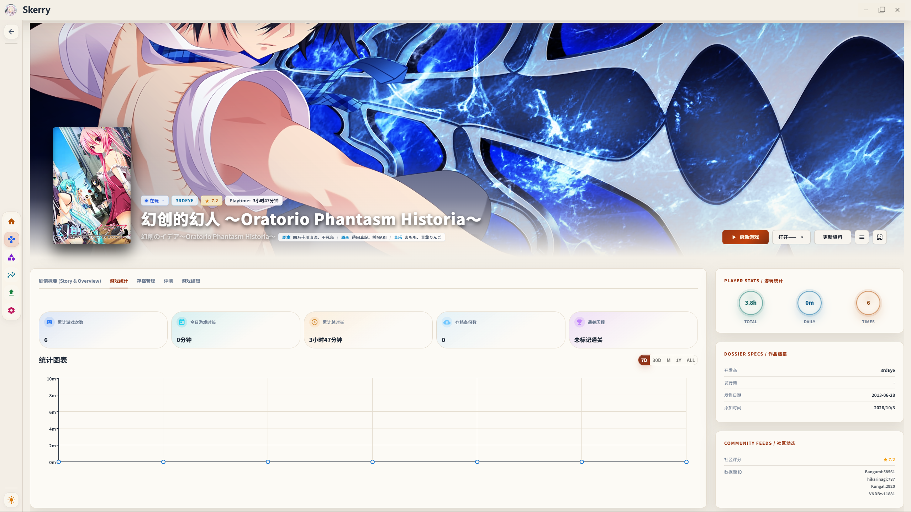
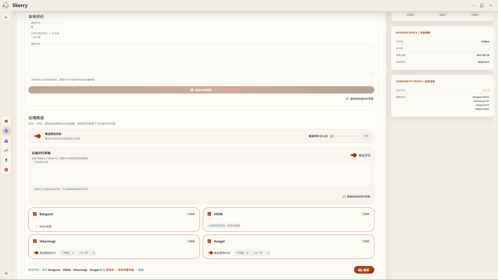
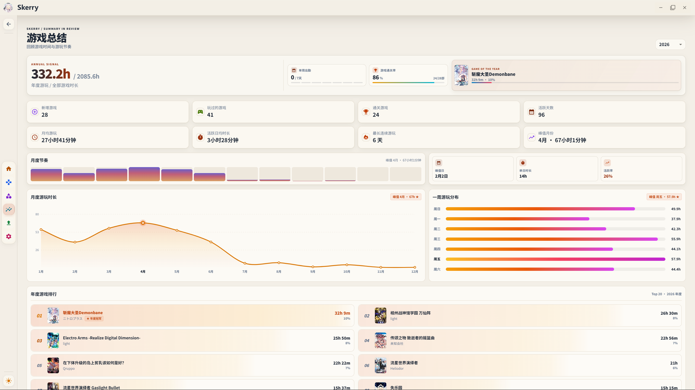

# Skerry

> 集成游戏库资产管理、多源信息更新、游玩状态记录、年度统计可视化与名台词系统的现代化桌面工作台。

Skerry 是由 ChaoxiYu9 独立维护的视觉小说管理与启动工作台，面向本地游戏库管理、作品资料维护与游玩记录。

> **长期目标**  
> 逐步自主重写前后端，最终摆脱网页封装形态，成为不再基于或扩展其他项目代码的独立产品。

项目地址：[ChaoxiYu9/Skerry](https://github.com/ChaoxiYu9/Skerry)  
English: [README.en.md](README.en.md)

## 功能

- 管理本地视觉小说库、启动程序与作品资料。
- 从多个数据源搜索和更新作品元数据，支持单个添加、批量导入与云端收藏导入。
- 管理封面、详情页背景与 CG 图库。
- 记录游玩状态与时长，查看月历、统计图表和年度游戏排行。
- 分别保存本地评价与云端评价，并可按应用提供的同步选项同步评价。
- 使用名台词、计划列表和随机游戏等辅助功能。
- 支持浅色与深色主题。
- 支持从 PotatoVN 导出文件导入本地游戏信息、数据源编号、封面和游玩记录。

## 截图

### 首页

### 游戏库

### 游戏详情

### 统计与评价

### 年度总结

## 从源码运行

### 环境要求

- Node.js 与 pnpm（项目锁定 pnpm 11.11.0）
- Rust 工具链（当前 Tauri 配置要求 Rust 1.97.1）
- 当前操作系统所需的 Tauri 构建依赖

### 安装与构建

    pnpm install
    pnpm tauri dev

构建前端：

    pnpm build

构建桌面安装包：

    pnpm tauri build

## 测试

`tests/` 保存项目的 Node.js 回归测试源码。当前 `package.json` 未提供统一的 `pnpm test` 脚本。

## 许可证与代码来源

Skerry 按 GNU AGPL v3 发布，完整许可文本见仓库根目录的 [LICENSE](LICENSE)。部分代码基于 [ReinaManager](https://github.com/huoshen80/ReinaManager) 扩展和改写；Skerry 由 ChaoxiYu9 独立维护。更新日志见 [CHANGELOG.md](CHANGELOG.md)。
